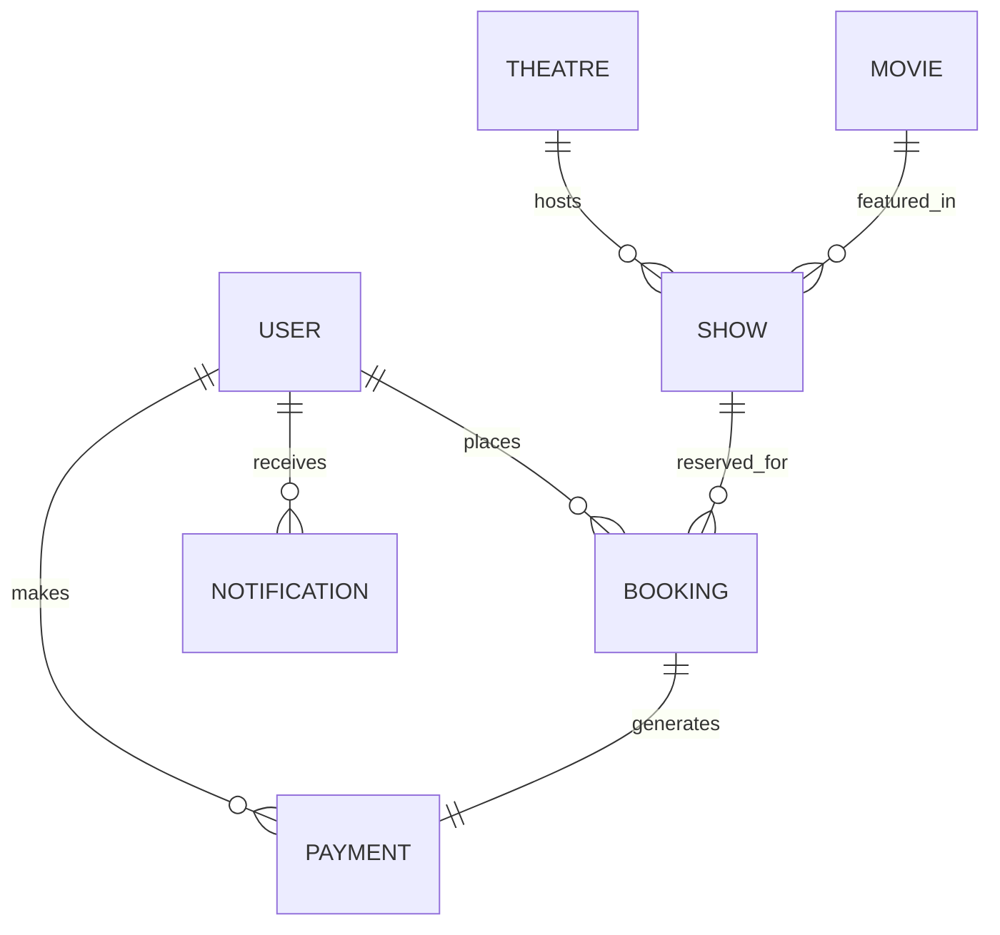

# 🎬 IMovies - Full-Stack Cinema & Ticket Booking System (MERN)

A modern, production-ready cinema management and ticket booking platform built with the **MERN Stack** (MongoDB, Express.js, React.js, Node.js) and **Socket.io** for real-time seat availability tracking and concurrency locking.

---

## 🌟 Key Features

### 1. 🍿 Cinematic User Experience
- **Hero Premiere Showcase:** Dynamic slider featuring blockbuster titles with high-definition banners, ratings, and embedded YouTube trailer modals.
- **Advanced Movie Discovery:** Search by keywords, filter by genre, language, minimum rating, and sort by latest release date or title.
- **Screening & Showtime Selector:** Multi-day date picker, city selector (New York, Los Angeles, London, Mumbai), and theatre listings with format badges (IMAX 3D, Dolby Cinema, 4DX).

### 2. 💺 Real-Time Interactive Seating Map (Socket.io)
- **Curved Cinema Screen:** Visual curved screen simulation with light projector beam and center aisles.
- **Tiered Seating:** VIP Plush Recliners, Premium Seats, and Standard tiers with color coding and price indicators.
- **Live Concurrency Lock:** Real-time seat reservation locking prevents double-booking. When a user selects a seat, other viewers see it locked immediately.
- **10-Minute Hold Timer:** Countdown timer automatically releases held seats if checkout is not completed.

### 3. 💳 Checkout & Simulated Payment Gateway
- **Transparent Cost Breakdown:** Ticket subtotal, per-seat convenience fee, and local taxes.
- **Promotional Coupons:** Instant discount calculation (e.g. `IMOVIES20` for 20% off, `CINEMA50` for 50% off).
- **Multiple Payment Methods:** Interactive virtual credit card preview, UPI QR code simulation, and Net Banking options.

### 4. 🎟️ Digital Admission Pass & Self-Service Cancellation
- **Verified Cinema Pass:** Perforated digital ticket with QR code pattern, booking ID, auditorium screen details, and print capability.
- **1-Click Ticket Cancellation:** Automated refund calculation (90% refund policy) with instantaneous seat release broadcast back to the seat map.

### 5. 🛡️ Cinema Command Center (Admin Panel)
- **Executive Analytics:** Total revenue metrics, total bookings count, active catalogue count, and registered audience counter.
- **Movie Catalogue Management:** Add, edit, and delete movie listings with poster URLs, cast members, runtime, certificates, and trailers.
- **Auditorium & Showtime Scheduling:** Schedule shows for specific dates and times with custom tiered pricing (VIP, Premium, Standard).
- **Global Bookings Ledger:** Real-time transaction ledger with status filters and customer audit details.

---

## 🛠️ Technology Stack

| Layer | Technologies |
|---|---|
| **Frontend** | React 18, Vite, Tailwind CSS, Lucide React, Socket.io-client, Canvas Confetti |
| **Backend** | Node.js, Express.js, Socket.io, Multer, Express Rate Limit |
| **Database** | MongoDB with Mongoose ODM |
| **Security** | JWT (JSON Web Tokens), bcryptjs password hashing, Role-Based Access Control (RBAC) |

---

## 🗄️ Database Design



### Collections:
1. **`users`**: Name, email, hashed password, phone, avatar, role (`user` | `admin`).
2. **`movies`**: Title, synopsis, poster, banner, trailer URL, genres, languages, duration, rating, certificate, cast, director.
3. **`theatres`**: Name, city, address, amenities (IMAX, Dolby Atmos), screens, seating capacity.
4. **`shows`**: Movie ref, Theatre ref, date, startTime, format, priceTiers, 70-seat layout matrix (`available` | `locked` | `booked`).
5. **`bookings`**: Booking ID (`IMV-XXXXXX`), user ref, show ref, seat numbers, subtotal, convenience fee, discount, total amount, status (`confirmed` | `cancelled`).
6. **`payments`**: Transaction ID, booking ref, user ref, payment method, amount, status (`success` | `refunded`).
7. **`notifications`**: User ref, title, message, type, read status.

---

## 🚀 Quick Start Guide

### Prerequisites
- **Node.js** (v18+ recommended)
- **MongoDB** running locally on port `27017`

### 1. Clone & Install Dependencies
```bash
# Install root, backend, and frontend dependencies
npm run install:all
```

### 2. Populate Database (Seeder)
```bash
npm run seed
```
> Populates 6 blockbuster titles (Dune: Part Two, Oppenheimer, etc.), 4 luxury theatres, 144 scheduled shows with seat maps, and default admin/user accounts.

### 3. Run Development Servers
```bash
# Terminal 1: Backend Server (Port 5000)
npm run server

# Terminal 2: Frontend Client (Port 5173 or 5174)
npm run client
```

Open your browser at: **`http://localhost:5174`** (or `http://localhost:5173`).

---

## 🔑 Pre-configured Demo Accounts

| Role | Email | Password | Privileges |
|---|---|---|---|
| **Cinema Director (Admin)** | `admin@imovies.com` | `admin123` | Full access to Admin Console, movie CRUD, show scheduling, revenue metrics |
| **Cinema Member (User)** | `user@imovies.com` | `user123` | Book tickets, view digital QR passes, profile management, ticket cancellation |

> 💡 *Quick demo autofill buttons are available directly on the `/login` screen.*

---

## 🏷️ Active Promo Codes
- **`IMOVIES20`** — 20% discount on ticket subtotal
- **`CINEMA50`** — 50% discount on ticket subtotal

---

## 📡 REST API Reference

### Authentication (`/api/auth`)
- `POST /api/auth/register` — Register a new account
- `POST /api/auth/login` — Sign in and receive JWT token
- `GET /api/auth/me` — Get authenticated user profile *(Private)*
- `PUT /api/auth/profile` — Update account profile *(Private)*

### Movies (`/api/movies`)
- `GET /api/movies` — List movies with search, genre, language, and rating filters
- `GET /api/movies/featured` — Get featured movies for hero carousel
- `GET /api/movies/:id` — Get single movie details
- `POST /api/movies` — Create movie *(Admin)*
- `PUT /api/movies/:id` — Update movie *(Admin)*
- `DELETE /api/movies/:id` — Remove movie *(Admin)*

### Shows & Seating (`/api/shows`)
- `GET /api/shows` — Query showtimes grouped by theatre (`movieId`, `date`, `city`)
- `GET /api/shows/:id` — Get show with full 70-seat layout and pricing tiers
- `POST /api/shows` — Schedule a new screening with auto-generated seats *(Admin)*
- `DELETE /api/shows/:id` — Cancel a screening *(Admin)*

### Bookings (`/api/bookings`)
- `POST /api/bookings` — Reserve seats, process payment, and issue ticket pass *(Private)*
- `GET /api/bookings/my-bookings` — Get current user's booking history *(Private)*
- `GET /api/bookings/:id` — Get booking confirmation details *(Private)*
- `PUT /api/bookings/:id/cancel` — Cancel booking with 90% refund and release seats *(Private)*
- `GET /api/bookings/admin/all` — Global bookings ledger with status filters *(Admin)*

### Admin Analytics (`/api/admin`)
- `GET /api/admin/stats` — Revenue stats, bookings counts, and recent transactions *(Admin)*
